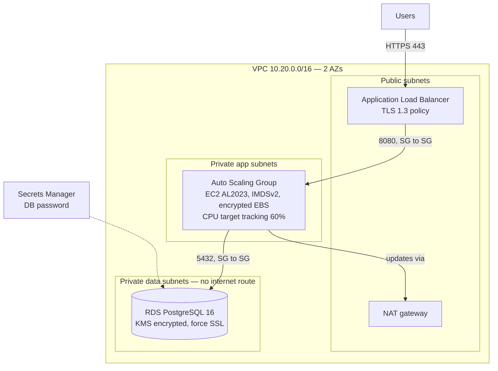

# terraform-aws-3tier

[](https://github.com/Rabbii96/terraform-aws-3tier/actions/workflows/terraform.yml)

A classic **three-tier AWS architecture** written as reusable Terraform modules, with a CI pipeline that
formats, validates, lints and security-scans every change. CI never touches AWS — it proves the code is
correct and safe *before* anyone runs `apply`.



## Modules

| Module | What it creates |
|---|---|
| `modules/network` | VPC, public / app / data subnets across 2-3 AZs, IGW, NAT (single for dev or one per AZ), route tables, VPC flow logs, locked default SG |
| `modules/compute` | ALB with HTTPS listener, target group + health check, launch template, Auto Scaling Group with rolling instance refresh and CPU target tracking, SSM instead of SSH |
| `modules/database` | RDS PostgreSQL in data subnets, customer KMS key, parameter group (force SSL, slow-query and DDL logging), enhanced monitoring, Performance Insights |
| `envs/dev` | Wires the modules together for a cheap dev environment |

## Security decisions

- **Least-privilege network path**: internet → ALB (443) → app (8080 from the ALB SG only) → DB (5432 from the app SG only). The data subnets have no route to the internet.
- **No SSH**: no key pairs, no port 22 — instances are reached with SSM Session Manager.
- **No secrets in code or state**: `manage_master_user_password` makes RDS generate the password and store it in Secrets Manager.
- **Encryption**: EBS and RDS encrypted, customer-managed KMS key with rotation, TLS 1.3 policy on the ALB, `rds.force_ssl = 1`.
- **IMDSv2 only** on instances (blocks the SSRF-to-credentials attack path).
- **Checkov** (security scan) runs in CI: 98 checks pass. Skipped checks are listed with a reason in `.checkov.yml` — all are cost/teardown trade-offs for **dev** (Multi-AZ, deletion protection, WAF, ALB access logs, 1-year log retention) that a prod environment turns on.

## CI

`terraform fmt -check` → `terraform init -backend=false` + `validate` → `tflint` (with the AWS ruleset) → `checkov`.

## Use it

```bash
cd envs/dev
terraform init
terraform plan  -var certificate_arn=arn:aws:acm:...:certificate/...
terraform apply -var certificate_arn=...
terraform destroy   # dev has deletion protection off on purpose
```

Costs money while running (NAT gateway, ALB, RDS) — destroy when you are done.
For a team setup, enable the S3 backend with state locking in `envs/dev/main.tf`.

---

By [Fazle Rabbi](https://www.linkedin.com/in/frabbii/) — SDET & DevOps engineer. AI-assisted (Claude Code), reviewed and validated before commit.
